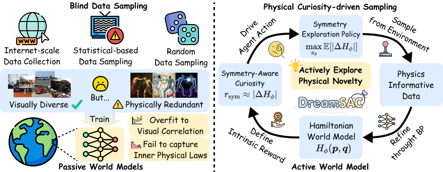

# [CVPR 2026] DreamSAC: Learning Hamiltonian World Models via Symmetry Exploration

**DreamSAC** is a model-based reinforcement learning agent that integrates structured world models with physics-inspired dynamics for robust visual control and zero-shot domain transfer.



## Abstract

Learned world models excel at interpolative generalization but fail at extrapolative generalization to novel physical properties. This limitation arises because they learn statistical correlations rather than the environment's underlying generative rules, such as physical invariances and conservation laws. We argue that learning these invariances is key to robust extrapolation. To achieve this, we first introduce **Symmetry Exploration**, an unsupervised exploration strategy where an agent is intrinsically motivated by a Hamiltonian-based curiosity bonus to actively probe and challenge its understanding of conservation laws, thereby collecting physically informative data. Second, we design a Hamiltonian-based world model that learns from the collected data, using a novel self-supervised contrastive objective to identify the invariant physical state from raw, view-dependent pixel observations. Our framework, **DreamSAC**, trained on this actively curated data, significantly outperforms state-of-the-art baselines in 3D physics simulations on tasks requiring extrapolation.

## Installation

Use Python 3.10 on Linux with an NVIDIA CUDA 12 driver:

```bash
python -m venv .venv
source .venv/bin/activate
python -m pip install -r requirements.txt
python -m pip check
```

`requirements-dmc.lock` pins the DMC dependencies and CUDA runtime packages.
The entry point locates pip-installed CUDA libraries automatically. MuJoCo uses
EGL by default. For OSMesa rendering, install the native OSMesa library and set
`MUJOCO_GL=osmesa PYOPENGL_PLATFORM=osmesa`.

## Two-Stage Training

Pretrain, then fine-tune with task rewards:

```bash
CUDA_VISIBLE_DEVICES=0 TASK=dmc_cheetah_run bash run.sh
CUDA_VISIBLE_DEVICES=1 TASK=dmc_quadruped_run bash run.sh
```

The default configuration uses `dreamsac_full`, the simple encoder/decoder,
1M pretraining steps and 500K fine-tuning steps. Set the output directory, budget
and seed explicitly for an experiment:

```bash
CUDA_VISIBLE_DEVICES=0 TASK=dmc_cheetah_run SEED=0 \
  PRETRAIN_STEPS=2000000 FINETUNE_STEPS=500000 \
  RUN_ROOT=logdir/cheetah_run/seed-0 bash run.sh
```

Use the same `RUN_ROOT` and configuration to resume an interrupted run. Fine-tuning
loads model, policy and value weights from the completed pretraining checkpoint,
starts fresh optimizer and reward-normalization state, and records parameter
verification in `finetune/transfer.json`.

| Variable | Default | Purpose |
| --- | --- | --- |
| `TASK` | `dmc_cheetah_run` | Environment task |
| `SEED` | `0` | Training seed |
| `PRETRAIN_STEPS` | `1000000` | Pretraining budget |
| `FINETUNE_STEPS` | `500000` | Fine-tuning budget |
| `RUN_ROOT` | Timestamped directory | Checkpoints, replay and logs |
| `USE_SAVI` | `False` | SAVi encoder and decoder |
| `USE_VIEWPOINT` | `False` | Viewpoint loss during pretraining |
| `REWARD_FREE` | `False` | Disable the task-reward replay-value loss during pretraining |
| `PYTHON` | `python` | Python executable |

Enable SAVi and viewpoint loss:

```bash
TASK=dmc_cheetah_run USE_SAVI=True USE_VIEWPOINT=True bash run.sh
```

On shared GPUs, `XLA_PYTHON_CLIENT_ALLOCATOR=platform` avoids reserving a large
GPU memory pool. Use a new output directory when changing model configurations.

### Run Stages Separately

```bash
python dreamsac/main.py \
  --configs dreamsac_full pretrain dmc_vision \
  --task dmc_cheetah_run --seed 0 --logger.outputs jsonl \
  --logdir logdir/cheetah_run/pretrain --run.steps 1000000

python dreamsac/main.py \
  --configs dreamsac_full finetune dmc_vision \
  --task dmc_cheetah_run --seed 0 --logger.outputs jsonl \
  --logdir logdir/cheetah_run/finetune --run.steps 500000 \
  --run.from_checkpoint logdir/cheetah_run/pretrain/ckpt/CHECKPOINT_ID \
  --run.from_checkpoint_regex '^(enc|dyn|dec|rew|con|pol|val|slowval)/' \
  --run.from_checkpoint_verify True
```

Each stage saves its full configuration as `config.yaml`.

## Acknowledgement

Some parts of this project are adapted from [DreamerV3](https://github.com/danijar/dreamerv3)
and [Slot Attention](https://github.com/evelinehong/slot-attention-pytorch).
We would like to thank the authors for their work.

## Citation

```bibtex
@inproceedings{tang2026dreamsac,
  title={DreamSAC: Learning Hamiltonian World Models via Symmetry Exploration},
  author={Tang, Jinzhou and Feng, Fan and Fu, Minghao and Lin, Wenjun and Yang, Jing and Huang, Biwei and Wang, Keze},
  booktitle={Proceedings of the IEEE/CVF Conference on Computer Vision and Pattern Recognition},
  pages={15188--15198},
  year={2026}
}
```
